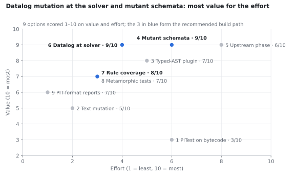
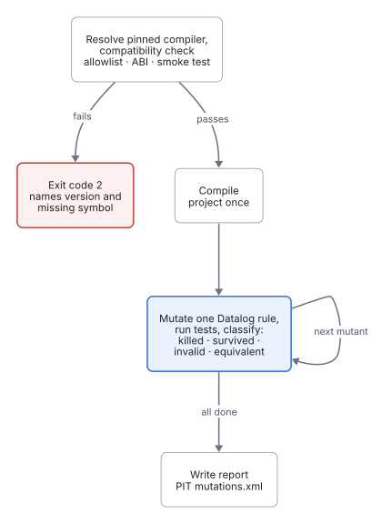
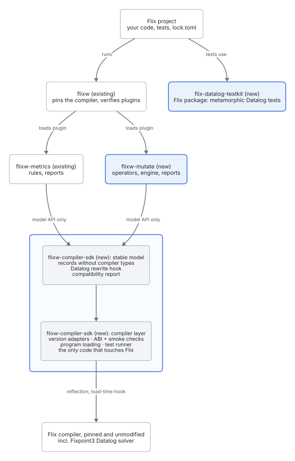

# Mutation testing for Flix

*Design draft, 5 November 2026. Source of truth for this document is this file; figures are generated from `diagrams/`, `data/` and `tools/` (see [Building](#building-this-document)).*

**Decision (5 Nov 2026):** start with option 6, Datalog mutation at the solver, shipped as a flixw plugin (`./flixw mutate`, this repository). We don't expect upstream changes to Flix to be accepted for now, so everything must work against unmodified Flix releases. PITest stays out.

## What decides the design

Reviewed: [flix/flix](https://github.com/flix/flix) at commit `99509a9` (HEAD on 5 Nov 2026), [wstein/flixw](https://github.com/wstein/flixw), [wstein/flixw-metrics](https://github.com/wstein/flixw-metrics), and [PITest](https://pitest.org).

- **Flix has its own test runner, not JUnit.** `tools/Tester.scala` takes tests from `LoadedProgram.tests`, each a `run` closure. PITest only knows JUnit and TestNG, so it would need a custom test plugin. The upside: anything holding a `LoadedProgram` can compile once and rerun tests in one JVM.
- **Flix bytecode is far from the source.** It has been monomorphised, erased, boxed, lambda-lifted and trampolined. The backend emits line numbers (`jvm/Instructions.scala`), but many bytecode mutants would hit runtime plumbing, not your logic.
- **Datalog runs on a solver written in Flix.** `Fixpoint3` turns constraints into a `Fixpoint3.Ast.Datalog` value (`Constraint(HeadPredicate, Vector[BodyPredicate])`) and evaluates it in `Solver.runSolverInternal`. Rules can be mutated as data at run time, with no recompile. This is the biggest finding.
- **flixw-metrics already solved the plumbing.** It has version-pinned compiler adapters, an `AdapterAbi` check of the compiler API, typed-AST access with source locations, and `DatalogGraph`, which finds recursive predicate groups. A mutation plugin can share that architecture through the SDK.

## Ratings at a glance

Options 6 and 4 reach top value at moderate effort; PITest scores lowest on value while costing more than most. Numbers match the option list below and [`data/ratings.csv`](data/ratings.csv).

## The options

1. **PITest on Flix bytecode — 3/10.** Needs a custom PIT test plugin wrapping `Tester`, plus filters for mutants in boxing, tag checks, effect-handler plumbing and trampolines. Mapping back to source stays weak, and most survivors would be equivalent noise. Worth a one-day spike for a baseline number, not a foundation.
2. **Text-level source mutation — 5/10.** Simple and works with any compiler version; mutants that fail to type-check are discarded cheaply. But every mutant costs a full compile, too slow for real projects, and text edits know nothing about types.
3. **Typed-AST plugin — 7/10.** Pick mutation sites from the typed AST, so every mutant is well-typed, and apply them as edits at the node's `SourceLocation`. Reuse the flixw-metrics adapter and `AdapterAbi` approach so it survives compiler upgrades. Flix-specific operators:
    - relational and arithmetic flips; boolean negation
    - `Some(x)` → `None` and `Ok` → `Err` where the types allow
    - swap the bodies of two match cases (deleting a case breaks exhaustiveness checking)
    - remove a `do Op`, or replace a `resume(x)` argument in an effect handler
    - swap operands of non-commutative calls such as `++` or `-`
    - lattice `⊔` / `⊓` swaps, which matter for lattice Datalog
    - prioritise pure definitions: cheapest and most reliable to test
4. **Mutant schemata — 9/10. Recommended for functional code.** Rewrite each site as `if (Mutant.on(17)) mutated else original`; both branches share a type, so it still type-checks. Compile once, load the `LoadedProgram` once, then per mutant set a static flag and rerun `program.tests` with a timeout. `Mutant.on` reads Java state, so it needs an `unsafe IO { … }` wrapper, which the stdlib itself uses in `Solver.flix`. Expect roughly 10–100× faster than options 2 and 3. Caveat: the switches change inlining, which can affect timeouts but not results.
5. **Mutation phase upstream in the compiler — 6/10.** Technically cleanest: a phase after Typer that emits the schemata. But it depends on the Flix maintainers wanting it. Not pursued: upstream changes are not expected to be accepted for now.
6. **Datalog mutation at the solver — 9/10. The answer for Datalog.** Hook `Solver.runSolverInternal` and rewrite the `Constraint` vector before solving: drop a rule or a body atom, negate or un-negate an atom, swap head variables, delete or flip a guard, drop facts. One compile, unlimited mutants. Chosen as the first step (see [Plan](#plan)).
    - A negation mutant can make the program unstratifiable; the Stratifier rejects it at run time. Classify that as *invalid*, not *killed*.
    - Weak mutation comes free: if the mutant's model differs from the original but no test fails, the tests never observe that relation. Identical models mean the mutant is equivalent, so it is excluded automatically.
    - Use `DatalogGraph` to prioritise rules inside recursive predicate groups, where the bugs live.
7. **Datalog rule-firing coverage — 8/10.** Fixpoint3 already has provenance (`runSolverWithProvenance`, `ProvenanceReconstruct`), so you can report which rules ever derived a fact during the suite. Cheap, and a prerequisite for option 6: a rule that never fires can't be killed. Fits flixw-metrics as e.g. `datalogRulesUnexercised`.
8. **Metamorphic Datalog tests — 7/10.** Properties that hold for any input, shipped as a small test library:
    - adding facts never removes derived facts, in strata without negation
    - solving twice equals solving once
    - `union` is commutative
    - `inject` then `facts` returns what went in
    - assertions about *why* a fact holds, via `provenanceOf`
9. **PIT-compatible reports — 7/10.** Write PIT's `mutations.xml` from whichever engine you build, so Sonar, the Stryker dashboard and existing CI viewers read the results unchanged.

## Plan

Option 6 comes first. Everything runs against unmodified, pinned Flix compilers; upstream pull requests are off the table for now and are revisited only once corpus data exists.

- [ ] Spike: hook `Solver.runSolverInternal` without changing Flix, testing both routes below on the currently pinned compiler
- [ ] Option 6: Datalog mutation at the solver, the first release of `./flixw mutate`
- [ ] Option 7: rule-firing coverage from the same hook
- [ ] Option 9: PIT-format `mutations.xml` from the first release
- [ ] Option 4: mutant schemata for functional code, once option 6 is stable

## Hooking the solver without upstream changes

With no hook in Flix, it has to come from outside the compiler. Both routes are unverified and run only inside the plugin's JVM; the user's project and installed compiler stay untouched.

| Route | How it works | Risk |
| --- | --- | --- |
| Bytecode rewrite at load time | The plugin loads the compiled program itself, so it controls class loading and can wrap the generated solver class so `runSolverInternal` passes the constraints through the mutator first. | Generated class and method names change between compiler versions. Guard with a per-version check in the style of `AdapterAbi` and refuse unknown versions. |
| Patched library source | Flix compiles its standard library from source shipped in the compiler jar; the plugin substitutes a `Fixpoint3/Solver.flix` with a transform step. | Unclear whether the compiler API allows replacing a library file. The patch must be rebased for each Flix version. |

Rule coverage (option 7) uses the same hook, so it comes almost for free.

### Compiler compatibility check

Before the first mutant, the plugin runs three checks and stops at the first failure:

1. **Version allowlist:** the version from `FLIXW_COMPILER_VERSION` must be listed in the SDK's `versions.json` with the `SolverHook` capability. The variable is absent without a lock: exit 2, naming the missing lock.
2. **ABI check:** in the style of `AdapterAbi`, reflection without initialisation confirms that the solver class, the hooked method's signature and the `Constraint` types exist exactly as the hook expects.
3. **Smoke test:** a small built-in Datalog program runs once unchanged and once with one rule dropped; the derived model must differ.

On failure the plugin exits with code 2, naming the compiler version (or the missing lock, see above) and the missing or mismatched symbol. It never reports a run silently as zero mutants killed.

### What flixw-metrics already provides

flixw-metrics detects an unsupported compiler well, but only structurally: it checks that classes and signatures exist, never that the compiler behaves as expected. Reviewed on 5 Nov 2026; paths are relative to `plugin/src/dev/flixw/metrics/`.

1. `Main.java` requires `FLIXW_ABI_VERSION=1`.
2. `CompilerCapabilities.inspect` loads the pinned compiler in an isolated class loader. For each adapter, `sdk/AdapterAbi.java` reads the adapter's own class files, including nested `$` classes, collects every `ca/uwaterloo/flix/*` reference and resolves it with `Class.forName(…, false, loader)` and an exact descriptor match. The compiler is never initialised.
3. `sdk/Adapters.java` picks the newest adapter whose references all resolve.
4. If none does, or a `LinkageError` occurs later, the plugin exits with code 2 and names the jar and the missing references.

Behaviour is checked only in CI: fixed expected values in `PluginIntegrationTest`, one test per adapter, and a weekly corpus calibration against compiler 0.77.0 alone. Twelve compiler versions from 0.60.0 to 0.77.0 are accepted; 0.59.0 and 0.66.0 are rejected on purpose.

For the solver hook these checks fall short, which turns into requirements for the shared SDK:

| Gap today | Consequence for the solver hook | Requirement for the SDK |
| --- | --- | --- |
| The ABI check sees only references in the adapter's own bytecode. | A hook made by reflection or bytecode rewriting is invisible to it; nothing references Fixpoint or the solver today. | Hook targets (class, method, descriptor) are declared in the contract and checked like any other reference. The `SolverHook` interface follows after the spike (#1). |
| Members are looked up through public `getMethods()` and `getFields()` only. | An internal Scala method is reported missing although it exists; a method with changed behaviour still passes. | Declared-member lookup for hook targets, always paired with the smoke test. |
| No behavioural check at run time. | A matching signature does not prove the hook works. | A run-time smoke test in the SDK, reusable by metrics. |
| `Adapters.resolve()` silently falls back to an older adapter. | A skipped adapter and its reason are lost. | Log skipped adapters and reasons; include them in the compatibility report header. |
| Calibration covers one compiler and metrics only. | Solver semantics on other versions are untested. | A CI matrix over the allowlist that runs the solver smoke test. |

## Delivery

The engine is a standalone jar; the product is a flixw plugin. No piece depends on changes to Flix.

| Piece | Ships as | v1 |
| --- | --- | --- |
| Datalog mutation engine | Standalone jar, no flixw dependency | Yes |
| `./flixw mutate` | flixw plugin, sharing the compiler-adapter SDK extracted from flixw-metrics | Yes |
| Standalone CLI | Same jar, `--compiler <flix.jar>` entry point | Optional |
| Metamorphic Datalog test helpers | Flix package | Yes |
| Solver hook and test-runner API | Upstream pull requests | Deferred: not expected to be accepted for now |
| Compiler mutation phase (option 5) | Upstream | Not pursued |

flixw supplies the pinned compiler, digest checks and the lock entry. flixw-metrics already reaches compiler internals through version-specific adapters, which the mutation plugin reuses for the solver hook and for running tests through the internal `Tester` classes.

## Shared compiler SDK

metrics and mutate share one library; no plugin ever imports a `ca.uwaterloo.flix` class directly, so a compiler update changes one place.

The SDK is one repository, `flixw-plugin-sdk`, with two modules. A plugin is one JAR and embeds a fixed SDK version; plugins never depend on each other at run time.

| Layer | Contains | Touches Flix internals |
| --- | --- | --- |
| `kit` (`dev.flixw.sdk.kit`) | Plugin shell, shared exit codes; knows nothing of Flix | No |
| `flix-bridge` (`dev.flixw.sdk.bridge`), depends on `kit` | Per-version adapters (one class per capability and Flix family), ABI driver (today `AdapterAbi`), version data (`versions.json`), stable model with no compiler types (today `CompilerModel`), `DatalogGraph` | Yes, only here |
| Plugins | metrics rules and reports; mutation operators, engine and reports | No |

The module is called `flix-bridge`, not `compiler`, because `compiler` is easily confused with the Flix compiler itself.

Capabilities: an adapter implements capabilities (`Metrics`, `ProgramLoader`, `TestRunner`, later `SolverHook`), and the linkage check runs per capability. The `SolverHook` interface is defined only after the spike (#1), not guessed with one consumer.

Boundaries: the stable model is the only `flix-bridge` API plugins see; besides it they use `kit`; rules, operators, engine and report formats stay in the plugins. Supported compiler versions are data in `versions.json` with the digest of each compiler JAR; the plugin reads `flixVersion` from `FLIXW_COMPILER_VERSION`. The SDK ships as a release asset with SHA-256, pinned by version and digest and embedded in each plugin; publishing stays an owner approval.

Until the first release asset exists, `flixw-mutate` pins the SDK source: `sdk-source.properties` records the repository, a full commit SHA and `module=kit`; `FLIXW_SDK_SOURCE` names a clean checkout at that SHA, verified byte for byte against the pinned Git blobs before packaging. `kit` is embedded in the one plugin JAR, and the report header names the plugin version, the pinned SDK revision and the `flixVersion`. The digest pin of the release asset replaces the commit pin when the asset is published.

Constraint: there is no access to the Flix repository and no upstream change is expected. Everything runs against unmodified stock compilers, and per-capability linkage checks are the only protection against compiler changes.

## Repository layout

| Repository | Status | Role | Depends on |
| --- | --- | --- | --- |
| wstein/flixw | Existing | Wrapper: pins the compiler, hosts and verifies plugins | — |
| wstein/flixw-plugin-sdk | New | `kit` + `flix-bridge`, extracted from flixw-metrics | Pinned Flix compiler (at run time) |
| wstein/flixw-metrics | Existing | Metrics plugin, slimmed to rules and reports | flixw-plugin-sdk |
| wstein/flixw-mutate | New (this repository) | Mutation engine jar + `./flixw mutate` plugin | flixw-plugin-sdk |
| wstein/flix-datalog-testkit | New | Flix package with metamorphic Datalog test helpers | Flix standard library |

The project runs `./flixw`, which loads both plugins; only the SDK's `flix-bridge` touches Flix.

## Open questions

- Which hook route works on the pinned compiler: bytecode rewrite or patched library source?
- Which of the twelve compiler versions flixw-metrics accepts also pass the solver smoke test, and so form the initial allowlist?
- Without a public test-runner API: run single tests through the internal `Tester` classes, or whole suites per mutant?
- Does the `Mutant.on` switch for option 4 type-check under the current effect system?

## Building this document

This file is plain Markdown so GitHub renders it directly. The figures are generated and committed:

| Figure | Source | Tool |
| --- | --- | --- |
| `figures/architecture.svg` | `diagrams/architecture.d2` | [D2](https://d2lang.com), pinned WebAssembly build (`tools/package.json`) |
| `figures/mutate-flow.svg` | `diagrams/mutate-flow.d2` | D2 |

D2 output is passed through `rsvg-convert` (librsvg), which turns its text into outlines so GitHub and the PDF show the same picture.
| `figures/ratings.svg` | `data/ratings.csv` | `tools/plot-ratings.py` (matplotlib) |

`scripts/docs.sh` regenerates the figures and renders a typeset PDF with [Quarto](https://quarto.org) and Typst to `docs/design/_build/DESIGN.pdf`. CI runs the same script on every change under `docs/`, warns if the committed figures are stale, and attaches the PDF to the workflow run as the `design-pdf` artifact.
